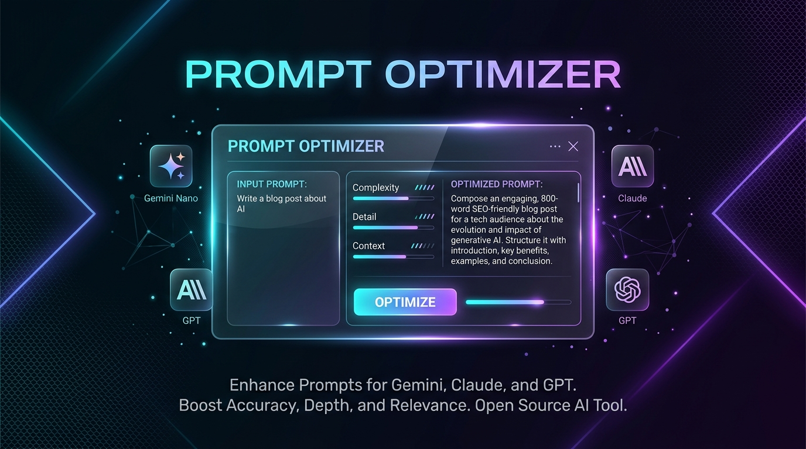
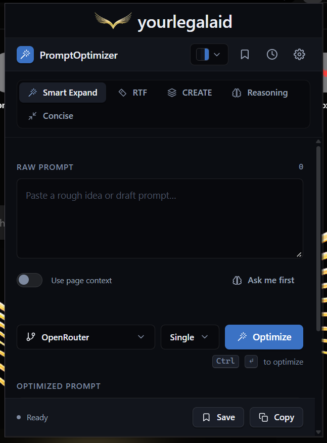
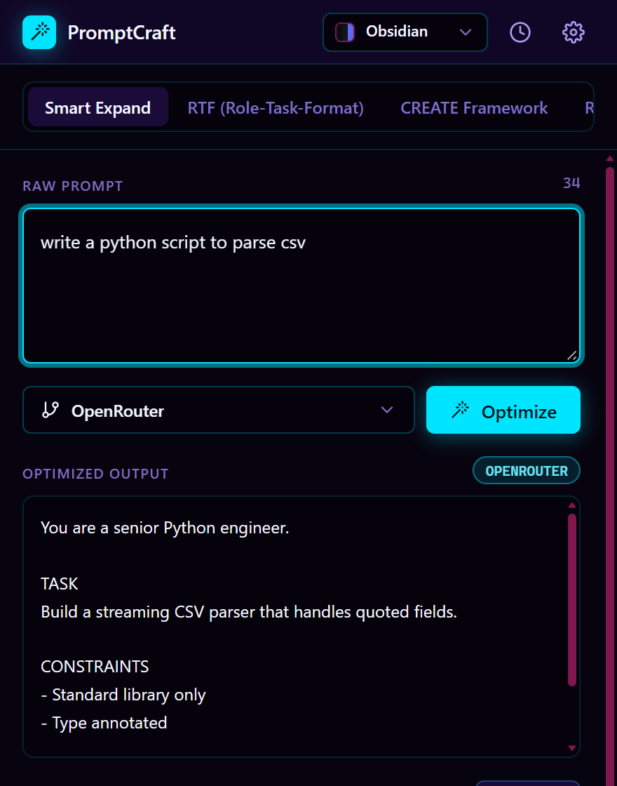
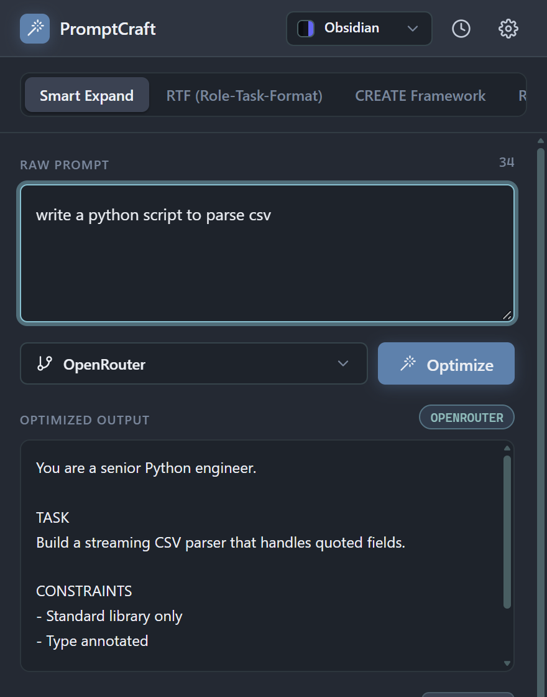
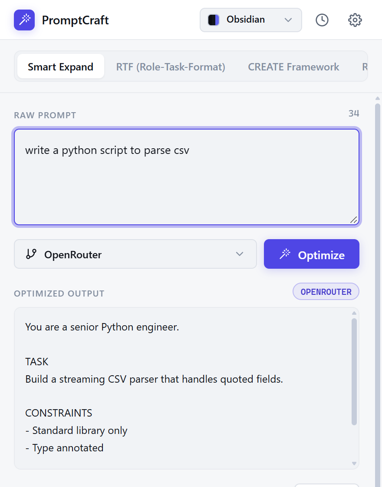
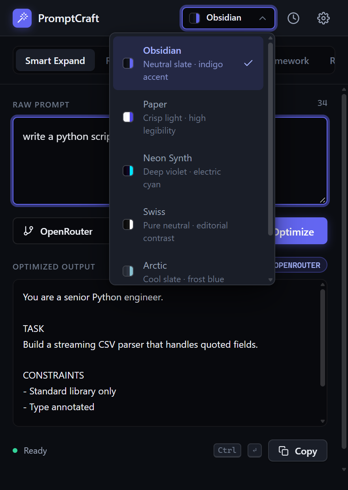
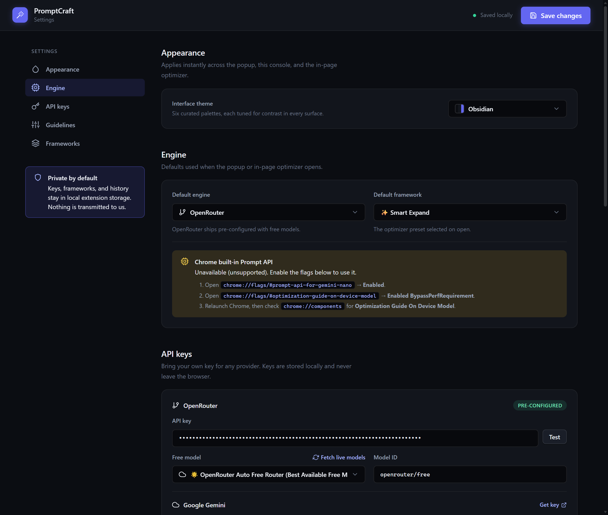

<p align="center">
  
</p>

<h1 align="center">PromptOptimizer</h1>

<p align="center">
  <b>Transform raw, lazy prompts into high-performance, structured instructions for every major AI model.</b><br>
  Runs 100% privately on-device with Chrome's built-in <b>Gemini Nano</b>, or connects to your own API keys for <b>Claude</b>, <b>GPT-4o</b>, <b>Gemini</b>, <b>DeepSeek</b>, and <b>OpenRouter</b>.
</p>

<p align="center">
  <a href="https://developer.chrome.com/docs/extensions/mv3/intro/"></a>
  <a href="#-privacy--security-perimeter"></a>
  <a href="#-15-accessible-design-themes"></a>
  <a href="#-project-architecture"></a>
  <a href="LICENSE"></a>
</p>

<p align="center">
  <a href="#-quick-tour--screenshots">Screenshots</a> •
  <a href="#-before--after-comparison">Before & After</a> •
  <a href="#-key-features">Key Features</a> •
  <a href="#-supported-ai-engines">Engines</a> •
  <a href="#-15-accessible-design-themes">Themes</a> •
  <a href="#-installation-guide">Installation</a> •
  <a href="#-project-architecture">Architecture</a>
</p>

---

## ⚡ Quick Tour & Live Interface

PromptOptimizer delivers a consistent, distraction-free optimization experience directly inside your workflow — available as both a toolbar popup and an in-page floating companion (`Alt+O`) on ChatGPT, Claude, Gemini, DeepSeek, and any custom web app.

<p align="center">
  
  <br>
  <em>Live PromptOptimizer interface featuring the <b>yourlegalaid</b> brand lockup, instant framework selectors, page context toggles, and multi-engine streaming.</em>
</p>

### 🎨 Theme Variations & Control Center

<table align="center" width="100%">
  <tr>
    <td align="center" width="33%">
      <b>⚡ Cyberpunk Glow</b><br><br>
      
    </td>
    <td align="center" width="33%">
      <b>❄️ Nord Frost</b><br><br>
      
    </td>
    <td align="center" width="33%">
      <b>☀️ Clean Light (Paper)</b><br><br>
      
    </td>
  </tr>
  <tr>
    <td align="center" width="50%">
      <b>🎨 15-Theme Swatch Picker</b><br><br>
      
    </td>
    <td align="center" width="50%">
      <b>⚙️ Engine & API Key Control</b><br><br>
      
    </td>
  </tr>
</table>

---

## 🎯 Before & After Comparison

See the difference between an unoptimized prompt and a PromptOptimizer rewrite tuned specifically for **Claude** using the **Smart Expand** framework:

### 🔴 Before (Lazy Draft)
```text
write an executive summary for our legal tech startup pitch
```

### 🟢 After (PromptOptimizer with Technique Chips)
> **Chips Applied:** `[Persona: Legal Tech Strategist]` `[XML Contract: <context> & <deliverables>]` `[Target: Claude 3.5]` `[Verification: Risk & Market Moat Check]`

```xml
<role>
You are an elite legal technology venture strategist and corporate attorney specializing in legal AI workflows, workflow automation, and enterprise B2B SaaS fundraising.
</role>

<context>
We are pitching our legal tech startup to early-stage venture investors. The platform resolves high-volume contract review bottlenecks, automated regulatory compliance checks, and secure document intelligence.
</context>

<instructions>
Draft a compelling, high-conviction 1-page Executive Summary structured with:
1. Executive Problem Statement (the cost and risk of legacy manual legal workflows)
2. Proprietary Solution & Competitive Moat (security perimeters, fine-tuned legal LLM precision)
3. Market Opportunity & TAM/SAM calculation
4. Traction & Milestones achieved to date
5. Unit Economics & 18-month Capital Deployment Roadmap
</instructions>

<output_contract>
- Tone: Crisp, data-driven, authoritative, investor-grade.
- Formatting: Clean Markdown headers, bulleted KPI highlights, bold metric anchors.
- Constraints: No generic marketing filler; ground all claims in defensible unit metrics.
</output_contract>

<verification>
Ensure every claim addresses key investor risks (data custody, accuracy thresholds, regulatory compliance, enterprise switching friction).
</verification>
```

---

## ✨ Key Features

### 1. 🚀 In-Page Companion & Native Insertion
- **Shadow DOM Isolation**: The in-page widget injects into a closed Shadow DOM root, guaranteeing that host page CSS cannot distort its layout.
- **Auto-Discovery**: Focus a chatbox on ChatGPT, Claude, Gemini, Perplexity, DeepSeek, Mistral, Grok, Copilot, or Poe to see the one-click **Optimize** trigger.
- **Smart Keyboard Shortcut (`Alt+O`)**: Instantly trigger the floating assistant on any page without leaving your keyboard (fully remappable in `chrome://extensions/shortcuts`).
- **Framework-Aware Insertion**: The **Insert** action emulates native keyboard and input events required by complex web editors (ProseMirror, Lexical, Draft.js, and React).

### 2. 🎯 Model-Specific Target Tuning
Every frontier AI model reasons differently. PromptOptimizer automatically shapes the output format to match your current platform:
- **Anthropic Claude**: Prefers structured XML boundaries (`<role>`, `<context>`, `<rules>`) and step-by-step reasoning constraints.
- **OpenAI (GPT-4o)**: Generates markdown-first directives with clear output schemas and negative constraints.
- **Google Gemini**: Adds analytical framing, data grounding, and research-grade clarity.
- **DeepSeek (V3/R1)**: Employs goal+verification proofs, test assertions, and step-by-step logic.
- **Grok**: Implements strict truth-verification and facts-vs-speculation demarcations.
- **Perplexity**: Enforces cited sources, temporal recency markers, and reference indexing.

### 3. 🛡️ Secret & Credential Leak Guard
PromptOptimizer guards your sensitive credentials before drafts ever touch a remote network. Built-in regex patterns detect:
- AWS access keys, GitHub personal access tokens, OpenAI/Anthropic API keys
- Private keys (`BEGIN RSA PRIVATE KEY`, etc.)
- Database connection strings and hardcoded passwords
- Drafts containing detected secrets are immediately paused with an explicit confirmation dialog before dispatch.

### 4. 📚 Prompt Library & `{{variable}}` Templates
- **Template Variables**: Create re-usable prompts containing dynamic parameters like `{{client_name}}`, `{{jurisdiction}}`, or `{{deadline}}`.
- **Bookmark Drawer**: One-click drawer in both popup and floating panel to fill variables and insert in seconds.
- **Local Storage**: Stores up to 500 prompts with tags and instant search, completely confined to your local browser storage.

### 5. 🌊 Real-Time Streaming & Refinement
- **Full Streaming**: Real-time token streaming for on-device Gemini Nano and cloud engines with instant **Cancel** support.
- **Cut-Off Detection**: Automatically senses when an LLM truncates at its token limit and provides a 1-click **Continue** continuation.
- **One-Tap Refinements**: Instantly ask the engine to make the prompt *Shorter*, *More formal*, or *Add concrete examples*.
- **"Ask Me First" Clarifications**: Generates up to 3 diagnostic questions highlighting missing details before finalizing the prompt.

---

## 🤖 Supported AI Engines

| Engine | Type | Privacy | Latency | Key Required? |
| :--- | :---: | :---: | :---: | :---: |
| **Chrome Gemini Nano** | On-Device | 🔒 100% Private (Zero telemetry) | ⚡ Instant (<100ms) | No (Built-in to Chrome) |
| **Anthropic Claude** | Cloud API | 🔑 Secure Direct API | ⚡ Streaming | BYOK (Claude 3.5 Sonnet / Haiku) |
| **OpenAI** | Cloud API | 🔑 Secure Direct API | ⚡ Streaming | BYOK (GPT-4o / GPT-4o-mini) |
| **Google Gemini Cloud** | Cloud API | 🔑 Secure Direct API | ⚡ Streaming | BYOK (Gemini 1.5 Pro / Flash) |
| **OpenRouter** | Cloud Multi-Model | 🔑 Secure Direct API | ⚡ Streaming | BYOK (Access 200+ models) |
| **Offline Templates** | Rule-Based | 🔒 100% Offline | ⚡ 0ms Instant | None (Instant fallback) |

> **Graceful Fallback:** If your selected cloud provider runs into a network error or rate limit, PromptOptimizer gracefully falls back to any configured alternative key, or drops down to the offline heuristic template while clearly notifying you of the source.

---

## 🎨 15 Accessible Design Themes

Every theme is handcrafted with custom tokens, tailored typography, and **100% WCAG AA contrast compliance**:

<div align="center">

| Theme | Mood | Palette | Mode |
| :--- | :--- | :--- | :---: |
| **Ink** | Default Obsidian | Deep carbon, crisp white, cyan accents | Dark |
| **Terminal** | Hacker Green | Matrix black, phosphor green `#00FF66` | Dark |
| **Ember** | High Voltage | Warm charcoal, vibrant flame orange `#FF5722` | Dark |
| **Harbor** | Oceanic Navy | Deep maritime blue, seafoam accents | Dark |
| **Contrast** | Maximum Legibility | Pure black `#000000` & crisp white `#FFFFFF` | Dark |
| **Amethyst** | Royal Purple | Velvet plum, glowing violet `#9D4EDD` | Dark |
| **Midnight** | Deep Space | Obsidian blue, starlight silver | Dark |
| **Aurora** | Northern Lights | Dark teal, shimmering emerald | Dark |
| **Paper** | Clean Editorial | Warm off-white `#F8F9FA`, graphite text | Light |
| **Manuscript**| Classic Print | Ivory parchment, serif accents, sepia ink | Light |
| **Sand** | Dune Minimal | Desert beige, warm clay highlights | Light |
| **Glacier** | Nordic Frost | Cool mist blue, steel slate text | Light |
| **Meadow** | Botanical | Fresh linen, forest sage `#2D6A4F` | Light |
| **Rose** | Soft Pastel | Blush chalk, terracotta rose `#C85A5A` | Light |
| **Ochre** | Architectural | Muted sandstone, burnt amber | Light |

</div>

---

## 🚀 Installation Guide

### Option 1: Load Unpacked in Chrome (Developer Mode)

1. Clone or download this repository:
   ```bash
   git clone https://github.com/jswizzle3737/PromptOptimizer.git
   ```
2. Open Google Chrome and navigate to `chrome://extensions/`.
3. In the top-right corner, toggle **Developer mode** to **ON**.
4. Click **Load unpacked** in the top-left corner.
5. Select the `prompt-optimizer-extension` folder.
6. Pin **PromptOptimizer** to your browser toolbar for instant access!

---

### Option 2: Enable Chrome's Built-in Gemini Nano (Free On-Device AI)

PromptOptimizer can run completely offline without needing any API keys or subscriptions using Chrome's built-in AI:

1. In Chrome (version 138+ recommended), navigate to:
   ```text
   chrome://flags/#prompt-api-for-gemini-nano
   ```
   Set to: **Enabled**
2. In the same flags screen, find:
   ```text
   chrome://flags/#optimization-guide-on-device-model
   ```
   Set to: **Enabled BypassPerfRequirement**
3. Click **Relaunch** at the bottom of the window.
4. Navigate to `chrome://components/`, locate **Optimization Guide On Device Model**, and click **Check for update**.
5. Once downloaded, PromptOptimizer will automatically detect Nano and run 100% locally on your machine!

---

## 🏗️ Project Architecture

Built purely with modern web standards — **Zero external npm dependencies**, zero build step required, pure native **Manifest V3**:

```text
prompt-optimizer-extension/
├── manifest.json              # Chrome Manifest V3 declaration
├── assets/                    # Hero banners, brand icons, and visual assets
│   ├── banner.png             # GitHub hero banner
│   └── logo.png               # Brand logomark
├── background/
│   ├── service-worker.js      # Streaming port dispatcher, context menus, shortcuts
│   └── nano-bridge.js         # Offscreen document bridge for Gemini Nano Prompt API
├── content/
│   ├── content.js             # Shadow DOM floating widget & keyboard listeners
│   └── content.css            # Root container styles (isolated from host page)
├── popup/                     # Browser action toolbar interface
├── options/                   # Settings, API key manager, and library explorer
├── offscreen/                 # Document runtime hosting the Prompt API for the service worker
├── shared/
│   ├── optimizer-engine.js    # Multi-engine orchestrator (Streaming, Nano, Fallbacks)
│   ├── assist.js              # Refine, Ask-Me-First, and Secret Protection UI
│   ├── clarify.js             # Clarification questionnaire parser
│   ├── secrets.js             # Client-side credential & key detection heuristics
│   ├── frameworks.js          # Optimization frameworks (Smart Expand, RTF, CREATE)
│   ├── target-profiles.js     # Model-specific XML/Markdown prompt shaping profiles
│   ├── theme-picker.js        # Dynamic theme token dispatcher (15 designs)
│   ├── theme.css              # Single-source-of-truth CSS custom property tokens
│   └── library.js             # Local prompt vault storage and search index
└── unit/                      # Native node:test validation suite
```

---

## 🧪 Testing & Verification

All tests run using Node.js's built-in test runner without requiring third-party libraries:

```bash
# Run unit tests across engines, migrations, frameworks & streaming
node --no-warnings --test "unit/*.test.mjs"

# Verify WCAG AA color contrast across all 15 themes
node check_contrast.js

# Validate DOM IDs and class contracts
node check_dom_contract.js

# Build production Chrome Web Store zip package
node package.mjs
```

---

## 🔒 Privacy & Security Perimeter

- **No Remote Telemetry**: PromptOptimizer does not track analytics, telemetry, or user behavior.
- **Air-Gapped Option**: With Gemini Nano or Offline Templates enabled, zero bytes ever leave your machine.
- **BYOK (Bring Your Own Key)**: When using cloud providers, requests are dispatched directly from your browser to the official provider endpoint (Google, OpenAI, Anthropic, OpenRouter) using your stored keys.
- **Secure Storage**: Keys are stored exclusively within Chrome's local extension storage and are never logged or exported.

---

## 📄 License

Distributed under the **MIT License**. See [`LICENSE`](LICENSE) for complete details.

<p align="center">
  <sub>Developed by <b>Jswizzle</b> • Designed for developers, researchers, and prompt engineers.</sub>
</p>
